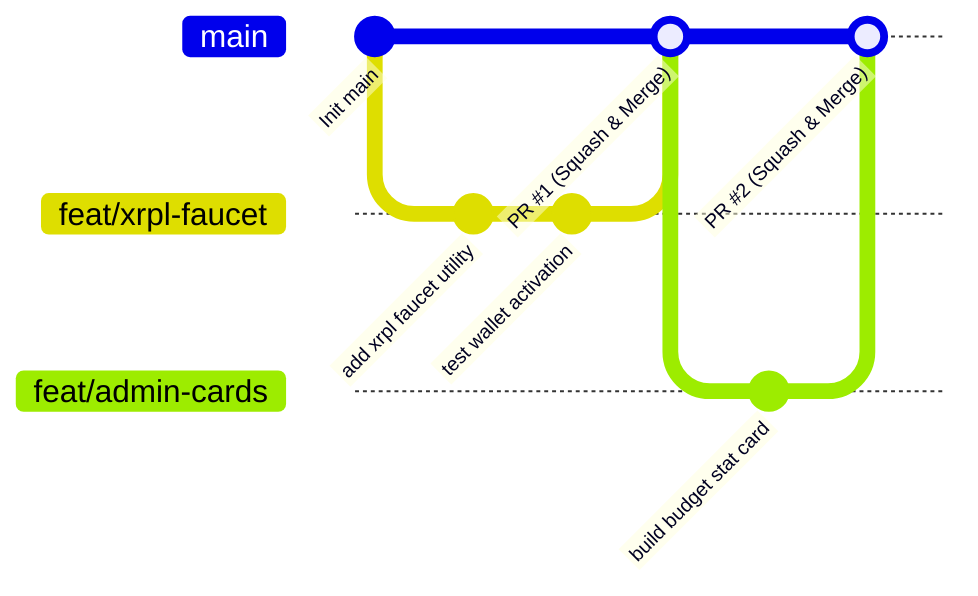

# FundFlow — Trunk-Based Collaboration Guide

Welcome to the team! This repository follows **Trunk-Based Development (TBD)** to ensure rapid, conflict-free collaboration between our on-campus lead and remote engineer using Git and GitHub Copilot CLI.

---

## 1. Core Principles of Trunk-Based Development (TBD)

1. **`main` is the Trunk:** The `main` branch is our single source of truth. It must **always be functional, runnable, and passing health checks**.
2. **Short-Lived Feature Branches:** Branches should live for a few hours (at most 1 day). Do not let branches sit idle for days.
3. **Small, Atomic Pull Requests:** Keep changes small (50–250 lines of code). Small diffs are easy to review in 3 minutes and rarely cause merge conflicts.
4. **Frequent Synchronization:** Pull and rebase from `main` multiple times a day before pushing your code.
5. **Strict Secret Protection:** Never commit `.env` or wallet seeds. The `.gitignore` is configured to prevent this automatically.

---

## 2. Getting Started (For Teammate Working from Home)

### Step 1: Clone the Repository
```bash
git clone <YOUR_GITHUB_REPO_URL>
cd "W3Node26 Hackathon"
```

### Step 2: Install Dependencies
Install dependencies for both backend and frontend:
```bash
# Install Server Dependencies
cd server
npm install

# Install Client Dependencies
cd ../client
npm install
```

### Step 3: Configure Environment
In the `server/` directory:
```bash
# On Windows PowerShell:
Copy-Item .env.example .env

# On Mac / Linux / Git Bash:
cp .env.example .env
```
*(No initial edits to `.env` are required; the server runs in zero-config development mode by default).*

### Step 4: Verify Local Setup
Open two terminal tabs:
```bash
# Tab 1: Start Backend (Port 5000)
cd server
npm run dev

# Tab 2: Start Frontend (Port 5173)
cd client
npm run dev
```
Visit `http://localhost:5000/api/health` to confirm the backend is online!

---

## 3. Daily Development Workflow



### Standard Loop for Every Feature

1. **Start from the latest `main`:**
   ```bash
   git checkout main
   git pull --rebase origin main
   ```

2. **Create a short-lived branch:**
   ```bash
   # Naming convention: feat/<short-description> or fix/<short-description>
   git checkout -b feat/policy-duplicate-check
   ```

3. **Make focused changes and commit:**
   ```bash
   git add .
   git commit -m "feat(policy): implement idempotency check for student disbursements"
   ```

4. **Rebase against `main` before pushing:**
   ```bash
   git fetch origin
   git rebase origin/main
   ```

5. **Push and open a Quick PR into `main`:**
   ```bash
   git push -u origin feat/policy-duplicate-check
   ```
   * Teammate reviews or self-merges (if pre-aligned).
   * Delete the feature branch once merged into `main`.

---

## 4. Conflict-Free Ownership Boundaries

To guarantee zero merge conflicts, tasks are separated by file ownership according to `docs/API_SPEC.md`:

| Developer | Primary File Paths | Core Responsibilities |
| :--- | :--- | :--- |
| **Developer 1 (MERN Lead)** | `client/src/**/*`<br>`server/src/controllers/**/*`<br>`server/src/routes/**/*`<br>`server/src/models/**/*` | Admin & Student dashboards, REST API endpoints, high-contrast Navy/Cyan styling. |
| **Developer 2 (Agent & XRPL Lead)** | `server/src/xrpl/**/*`<br>`server/src/policy/**/*`<br>`server/src/agent/**/*`<br>`server/tests/**/*` | XRPL Testnet connection, test wallet faucet, Independent Policy Engine, autonomous AI disbursement loop. |

*Note: If both developers need to modify shared contracts, discuss and update `docs/API_SPEC.md` first!*

---

## 5. GitHub Copilot CLI Cheatsheet

For the remote developer using GitHub Copilot CLI in their terminal:

* **Ask for code suggestions:**
  ```bash
  gh copilot suggest "In xrpl.js, write an async function to submit a Payment transaction and check for tesSUCCESS"
  ```
* **Explain unfamiliar blockchain errors:**
  ```bash
  gh copilot explain "tecUNFUNDED_PAYMENT error in xrpl transaction result"
  ```
* **Generate unit tests:**
  ```bash
  gh copilot suggest "Write a test in Jest or Node for policyEngine checking monthly allowance limit"
  ```

---

## 6. Architecture & Specs Reference
* Full Architectural Brief: [`docs/TEAM_BRIEF_AND_ARCHITECTURE.md`](docs/TEAM_BRIEF_AND_ARCHITECTURE.md)
* Compiled Printable PDF: [`docs/FundFlow_Team_Brief_and_Architecture.pdf`](docs/FundFlow_Team_Brief_and_Architecture.pdf)
* API Contract Specification: [`docs/API_SPEC.md`](docs/API_SPEC.md)
